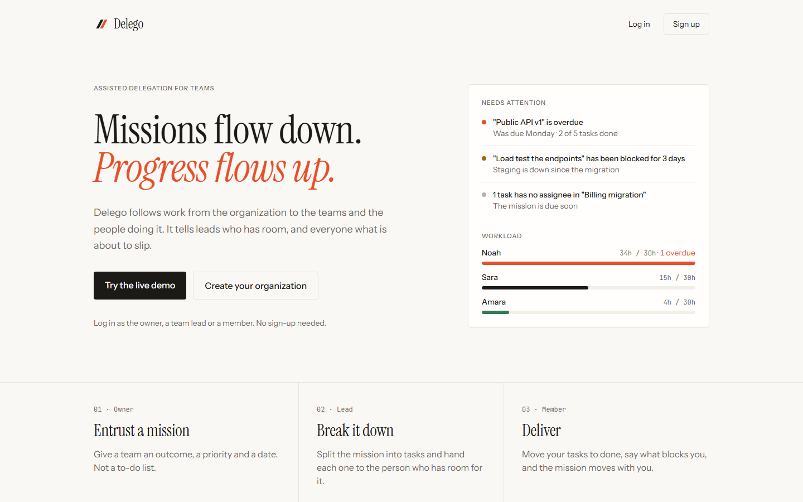
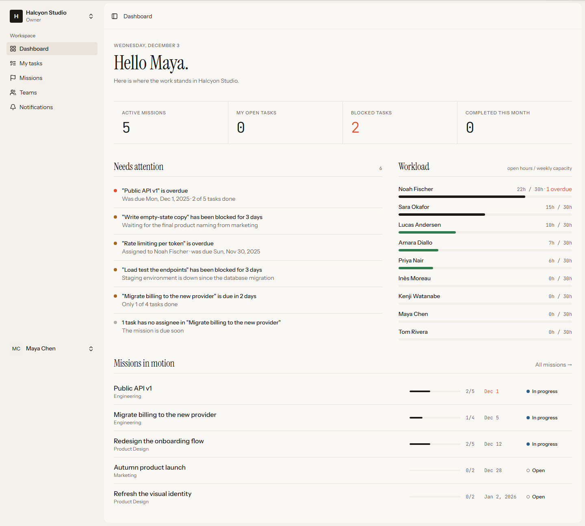
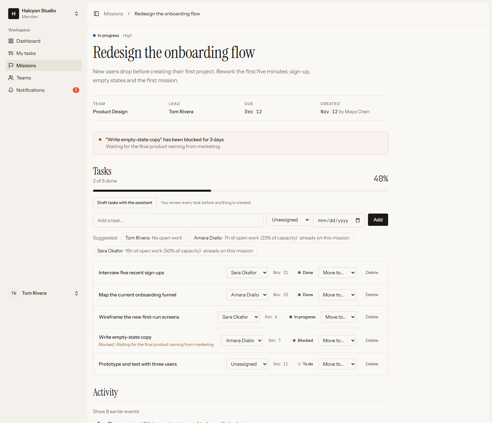
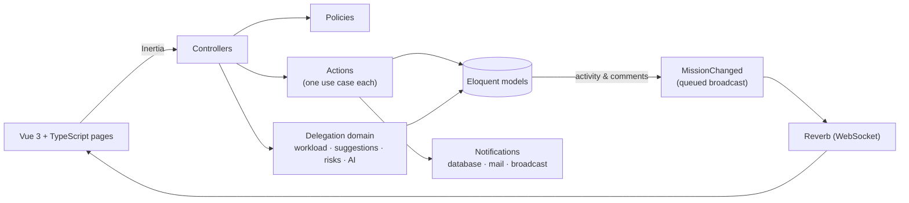
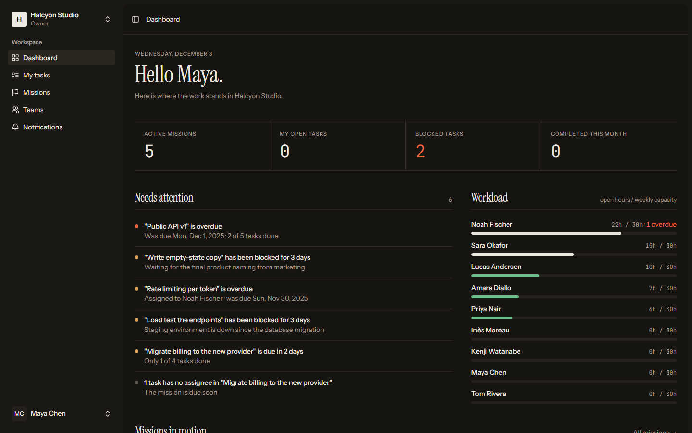

<p align="center">
  
</p>

<h1 align="center">Delego</h1>

<p align="center">
  <strong>Assisted delegation for teams.</strong><br>
  Missions flow down from the organization to team leads and members. Progress flows back up.
</p>

<p align="center">
  <a href="../../actions/workflows/ci.yml"></a>
  
  
  
  
</p>

<p align="center">
  
</p>

## Why Delego

Most task tools are flat: one board, everyone on the same level. Real organizations delegate. Someone **entrusts** an outcome to a team, a lead **breaks it down** and hands each part to the person who has room for it, and everyone needs to know **what is about to slip**.

Delego is built around that chain, and it helps at each step with rules you can read, plus an optional AI assistant you can switch off.

| Owner | Lead | Member |
|---|---|---|
| Entrusts a mission to a team, with a priority and a due date | Breaks it down into tasks, assigns them with suggestions based on real workload | Moves their tasks forward, says what blocks them |

## Highlights

- **Workload, measured.** Each person's open estimated hours against a weekly capacity, across every team they work in.
- **Assignment suggestions that explain themselves.** "Amara · 7h of open work (23% of capacity) · already on this mission".
- **Risks before they bite.** Overdue and soon-due missions, tasks blocked for days, unassigned work, overloaded people, ranked by severity.
- **A strict task workflow.** To do → in progress → blocked (with a reason) → done, with only meaningful transitions. The first started task starts the mission; the lead completes it once every task is done or cancelled.
- **Optional AI breakdown.** Drafts the tasks of a mission through any OpenAI-compatible API (free models work), falls back to the next model when one is saturated, and never creates anything the lead has not reviewed.
- **Live.** Mission pages update for everyone looking at them, with presence ("Sara is here too") and a live notification counter. If the WebSocket server is down, nothing breaks.
- **Multi-organization.** Owner, admin and member roles per organization, email invitations, strict isolation between organizations.
- **Everything in one thread.** Comments and a readable activity log on each mission; in-app and email notifications to the right people only.

<p align="center">
  
</p>

<p align="center">
  
</p>

## Try it locally

Requirements: PHP 8.3+, Composer, Node.js 22.

```bash
git clone https://github.com/FenoAndria/team-flow.git delego
cd delego
composer install
npm install

cp .env.example .env
php artisan key:generate
php artisan migrate --seed   # creates the Halcyon Studio demo organization
```

Set `DELEGO_DEMO=true` in `.env` to get one-click login on the login page, then:

```bash
composer run dev   # web server, queue worker, Reverb, logs and Vite
```

Open <http://localhost:8000> and log in as **Maya** (owner), **Tom** (lead) or **Sara** (member). Every demo account uses the password `password`.

### Optional features

| Feature | How to turn it on |
|---|---|
| Real-time updates | `BROADCAST_CONNECTION=reverb` and any random `REVERB_APP_ID`, `REVERB_APP_KEY`, `REVERB_APP_SECRET` |
| AI breakdown | `DELEGO_AI_API_KEY` and `DELEGO_AI_MODEL` (a comma-separated list of fallback models is accepted) for any OpenAI-compatible API, e.g. free models on OpenRouter |
| Weekly capacity | `DELEGO_WEEKLY_CAPACITY_HOURS` (30 by default) |

Free AI models may keep your prompts. Demo data is fictional; use a paid key or a no-retention model for real data.

## Architecture



- **Laravel 12 + Inertia 2 + Vue 3 (TypeScript).** No separate REST API to maintain: routing, validation and authorization stay on the server.
- **Actions** (`app/Actions`) hold the business rules, one use case per class, each in a transaction: inviting, accepting, changing roles, moving tasks, completing missions.
- **Delegation domain** (`app/Delegation`) is independent from HTTP: `WorkloadCalculator`, `AssigneeSuggester`, `RiskDetector` and the optional AI client, all tested directly.
- **Policies** decide what an owner, an admin, a lead or a member may do; every resource of another organization behaves as if it did not exist (404).
- **Native PHP enums** carry the workflows (`TaskStatus::transitions()`), so the interface only offers what the server would accept.

## Quality

| | |
|---|---|
| Tests | 171 Pest tests on business rules, permissions and organization isolation |
| Static analysis | Larastan (level 6) |
| Code style | Pint, ESLint, Prettier |
| CI | GitHub Actions: quality checks, and tests on PHP 8.3 and 8.4 |

```bash
composer test
composer analyse
composer lint
npm run lint:check
```

## Design

The *Ink & signal* design system: warm paper, ink text, hairline rules, no shadows, and a single vermilion reserved for the brand and for what needs attention. Instrument Serif for titles, Instrument Sans for the interface, JetBrains Mono for figures, all self-hosted. Light and dark themes.

<p align="center">
  
</p>

## From Team Flow to Delego

Delego is the rewrite of **Team Flow**, a 2024 learning project (Laravel 10 REST API + Vue SPA with Vuex), kept under the [`v1-2024`](../../tree/v1-2024) tag. The rewrite kept the domain and changed almost everything else:

| Team Flow (2024) | Delego |
|---|---|
| One global admin, roles inferred at login | Organizations with owner / admin / member roles |
| Polling every 2 s through a single global flag | Reverb WebSockets with presence |
| Three near-identical notification tables, read flag unused | Native Laravel notifications (database, mail, broadcast) |
| No tests | 171 tests, static analysis, CI |
| A task could be closed with no subtasks done | Explicit, tested workflow |
| Token in localStorage, no logout on the server | Session authentication through Inertia |

Each feature of the rewrite has a short progress report (in French) in [`docs/cr`](docs/cr).

## License

MIT
